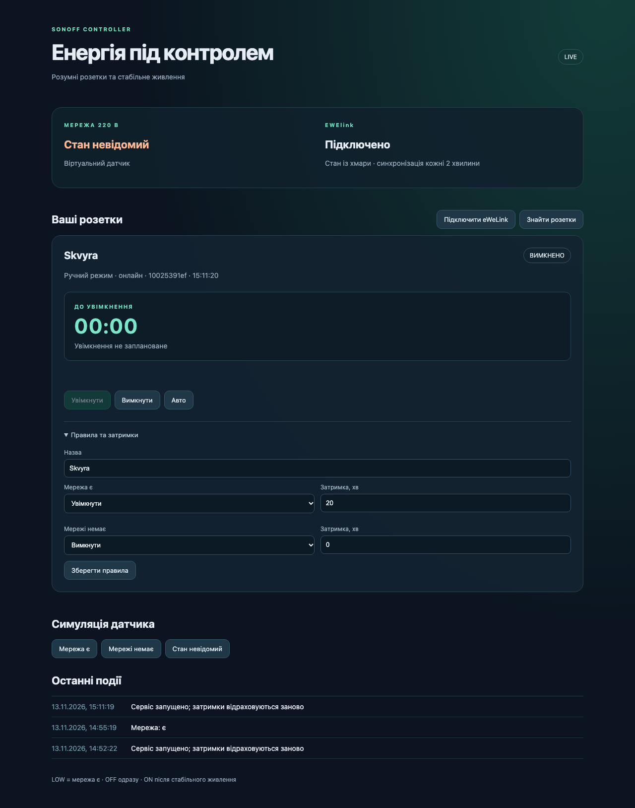

# Sonoff Controller

Python-сервіс і українська вебпанель для Raspberry Pi Zero 2 W. Відстежує цифровий сигнал наявності мережі й керує Sonoff через eWeLink. Типовий сценарій бойлера: **OFF одразу при зникненні; ON після 20 хвилин безперервного живлення**.

## Що реалізовано

- Незалежні правила `on/off/hold` і затримки кожної розетки, до 10 пристроїв.
- Скасування ON при будь-якому зникненні сигналу, блокування ON за невідомого стану.
- Ручне керування й повернення в auto. Ручний ON дозволений тільки за наявності мережі. Правило OFF при зникненні діє також у manual; після повернення manual не вмикається автоматично.
- Редагування правил, живий відлік «До увімкнення» у MM:SS, підтверджений/останній відомий стан, журнал у SQLite. Відлік оновлюється щосекунди; для вже увімкненого пристрою показує 00:00. Підтверджений достроковий ON скасовує заплановану команду.
- Basic Auth, захист записів токеном, OAuth eWeLink з перевіркою state й оновленням credentials.
- Docker + Caddy із Let's Encrypt; GPIO через libgpiod або віртуальний датчик.

Після старту та редагування правил затримка відраховується заново. OFF ставиться на виконання на першому зчитуванні відсутності (опитування 50 мс); фактичне перемикання залежить від доступності мережі, хмари та розетки. Затримка відраховується monotonic clock, а не системним часом.

## Локальний запуск у симуляції

Потрібен Python 3.12. Для mock режиму APPID/SECRET не потрібні.

```sh
python3.12 -m venv .venv
.venv/bin/pip install -e '.[dev]'
cp .env.example .env
python3 scripts/new_password.py
```

Вставте згенерований пароль у `WEB_PASSWORD` у `.env`. Ніколи не комітьте `.env`. Для локального запуску завантажте його у середовище оболонки:

```sh
set -a
. ./.env
set +a
.venv/bin/uvicorn sonoff.app:create_app --factory --host 127.0.0.1 --port 8080 --workers 1 --no-access-log
```

Відкрийте `http://127.0.0.1:8080`, введіть `WEB_USERNAME` і пароль. Кнопки симуляції змінюють стан датчика; затримку можна тимчасово зменшити в правилах. Невідомий початковий сигнал блокує ON.

## Docker у симуляції

Після створення `.env` і пароля:

```sh
docker compose up --build -d app
docker compose ps
```

Панель доступна лише на localhost:8080. Для віддаленого тестування використайте SSH tunnel або HTTPS нижче. Не публікуйте незашифрований порт із Basic Auth.

## HTTPS / Let's Encrypt

Caddy автоматично отримує та поновлює сертифікат Let's Encrypt. У `.env` задайте реальні `DOMAIN`, `ACME_EMAIL`, `EWL_REDIRECT_URL=https://<домен>/oauth/callback`.

Потрібні публічний DNS A/AAAA вашого домену до цього сервера та доступність портів 80/443 (для домашньої мережі — forwarding на Raspberry). Некоректний AAAA також заважає перевірці. За CGNAT або без відкритих портів цей HTTP/TLS challenge не працює: потрібен DNS challenge з модулем вашого DNS-провайдера; він ще не налаштований. Домашнє ім'я `.local` не отримує публічний сертифікат Let's Encrypt.

```sh
docker compose --profile https up --build -d
docker compose logs --tail 50 caddy
```

Відкрийте `https://<домен>`. Облікові дані перевіряє застосунок; Caddy завершує TLS і перенаправляє HTTP на HTTPS. Volume `caddy_data` зберігає сертифікати, `controller_data` — правила, токени та журнал. Не видаляйте volumes для звичайного оновлення.

## eWeLink і реальні розетки

Compose завантажує app credentials `EWL_APPID`, `EWL_SECRET` з `../.env` (за наявності), потім налаштування з `.env`. Секрети не вбудовуються в образ. APPID/SECRET самі по собі не дають доступу до розеток.

Наявний `../tokens.json` можна імпортувати без повторного OAuth: додайте `-f compose.ewelink.yaml` до команд Compose (разом із GPIO override). Цей файл монтується read-only; після першого імпорту ротація зберігається в SQLite, а вихідний JSON не переписується. Сервіс використовує вже збережені токени перед імпортним файлом. У systemd-unit також додайте `-f compose.ewelink.yaml` в обидві команди. На Raspberry файл має бути читабельний користувачу контейнера UID 10001, але не загальнодоступний; для окремого імпортного файла можна встановити owner 10001 і mode 0400. Якщо імпортний токен прострочений або відкликаний — повторіть OAuth через UI.

Для локального сервісу `EWL_TOKEN_FILE=../tokens.json`. Для дозволеного live smoke test лише Skvyra (`10025391ef`): `.venv/bin/python scripts/test_skvyra.py`. Скрипт виконує OFF → ON і відновлює початковий стан; усі секрети читає з батьківського каталогу і не друкує. Фактичний тест пройдено: OFF підтверджено, ON підтверджено, відновлено OFF.

1. Зареєструйте точний HTTPS redirect URL у https://dev.ewelink.cc.
2. Підключіть підтверджений датчик і задайте `CLOUD_BACKEND=ewelink`, `SENSOR_BACKEND=gpio`.
3. Для реального запуску підготуйте початковий конфіг **без** `demo-boiler`: створіть `config/config.json` із `"sockets": []` і потрібними параметрами `sensor`; змініть bind mount Compose на цей файл. На новому volume конфіг завантажується з файла, надалі правила зберігаються в SQLite й редагуються через UI.
4. Запустіть сервіс, натисніть «Підключити eWeLink» і авторизуйте свій обліковий запис. Регіон береться з OAuth callback. Натисніть «Знайти розетки».
5. Виберіть пристрій/канал: **«Додати» активує автоматизацію**, включаючи OFF за відсутності мережі. Одна керована лінія на device ID; кілька каналів одного пристрою одночасно ще не підтримуються.

Токени зберігаються в SQLite з правами 0600. Їх ротація транзакційна. Не передавайте копії бази стороннім. Прострочений refresh token потребує нової OAuth-авторизації.

Стани синхронізуються одним batch-запитом для ≤10 розеток кожні 120 секунд (~21 600/30 днів), плюс discovery, команди й readback. Це враховує документований free quota 50 000/місяць/регіон. WebSocket у цій версії не реалізований; зовнішні перемикання можуть відображатись із затримкою до 2 хвилин. Після команди виконується readback; HTTP-успіх сам по собі не означає виконання.

## Raspberry / GPIO

Детектор з опису https://rozetka.com.ua/ua/473599514/p473599514/ має **LOW при наявності 220 В, HIGH при відсутності**. Вказані TTL 3–5 В та адаптація до 24 В ПЛК не визначають безпечне пряме підключення до Pi. Потрібна схема/підтвердження open-collector або відповідний перетворювач рівнів. GPIO не толерантний до 5/24 В.

Після підтвердження виходу 0–3.3 В: сигнал → **BCM GPIO17 / фізичний пін 11**, signal-side GND → **пін 6**. `present_level=0`; вхід використовує pull-up. Сторона 220 В не з'єднується з GPIO/GND Pi. Не підключайте Pi-side живлення до клеми 24 В. Остаточну схему узгоджуємо після підтвердження виходу детектора.

На Pi OS Lite 64-bit визначте пристрій і групу:

```sh
ls -l /dev/gpiochip*
getent group gpio
```

Задайте в `.env` фактичні `GPIO_DEVICE` і `GPIO_GID`. Override відображає вибраний host device на `/dev/gpiochip0` у контейнері; `GPIO_LINE=17` означає offset line на вибраному chip, який треба перевірити на Pi.

```sh
docker compose -f compose.yaml -f compose.gpio.yaml --profile https up --build -d
```

Привілейований контейнер не потрібен. Один worker обов'язковий. GPIO та live eWeLink ще не перевірені на реальному Raspberry/розетках. Raspberry, Wi-Fi, інтернет і Sonoff повинні лишатись доступними під час контрольованої аварії для відправлення OFF. Перевірте power-on state Sonoff: сервіс не може запобігти його самостійному увімкненню до доступності хмари.

## Розробка й перевірки

```sh
.venv/bin/pytest -q
.venv/bin/ruff check src tests scripts
.venv/bin/ruff format --check src tests scripts
```

Тести використовують mock-cloud і підставний годинник; реальні розетки не перемикаються. Production ARM64/GPIO залежності зафіксовані в `requirements.lock`, універсальний lock — `uv.lock`; для відтворюваного development середовища використовуйте `uv sync --extra dev --locked`. Структура: `src/sonoff/` — сервіс і static UI, `tests/` — перевірки, `config/` — початковий конфіг, `deploy/` — Caddy. Деталі в [docs/architecture.md](docs/architecture.md).

## Автозапуск після перезавантаження Raspberry

Обидва контейнери мають `restart: always`. Для гарантії старту Docker й запуску Compose встановіть systemd-unit із репозиторію. Інструкція передбачає клон репозиторію в `/opt/sonoff`, налаштований `.env`, підтверджений GPIO та домен. Якщо шлях інший, змініть `WorkingDirectory` у unit.

```sh
sudo systemctl enable --now docker
sudo install -m 644 deploy/sonoff-controller.service /etc/systemd/system/sonoff-controller.service
sudo systemctl daemon-reload
sudo systemctl enable --now sonoff-controller.service
sudo systemctl status sonoff-controller.service
docker compose ps
```

Після наступного перезавантаження systemd підніме Docker і GPIO/HTTPS Compose. Завантаження не потребує OAuth повторно, доки refresh token чинний. Наявність мережі визначається заново: ON лише після повних 20 хвилин; за її відсутності — OFF. Домен і доступність хмари не змінюють того, що сервіс моніторить локальний GPIO.

Для симуляції без GPIO/HTTPS змініть `ExecStart` на `/usr/bin/docker compose up -d --wait app`, а `ExecStop` на `/usr/bin/docker compose stop app`. Не вмикайте два різні проєкти Compose для одного GPIO. Звичайне оновлення після `git pull`: `sudo systemctl restart sonoff-controller`; якщо змінився код/залежності, перед restart виконайте `docker compose build app`.

## Локальна панель із реальною Skvyra

```sh
docker compose -f compose.yaml -f compose.local.yaml up --build -d app
```

Відкрийте http://127.0.0.1:8080. Логін `admin`, пароль — `WEB_PASSWORD` у локальному `.env`. Override імпортує `../tokens.json`, використовує eWeLink і віртуальний датчик; Skvyra стартує в manual. Кнопки симуляції змінюють сигнал, а кнопки ON/OFF справді перемикають розетку. Не використовуйте цей mock-sensor override для бойлера в робочому середовищі. Спільний volume зберігає налаштування між перезапусками, тому перемикання між local/production вимагає перевірки списку й режимів у UI.


